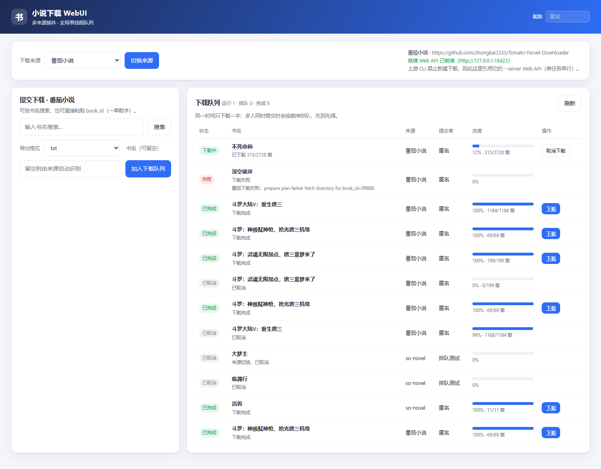
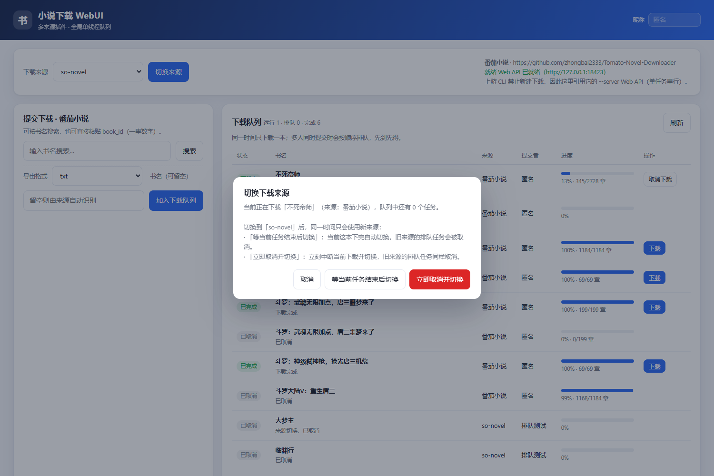

# 小说下载 WebUI（多来源插件版）

一个可以部署在自己服务器上的网页端小说下载器。它本身**不实现任何站点解析或下载逻辑**，
而是把两个成熟的开源下载器当作「来源插件」引用：

| 来源 ID | 上游项目 | 接入方式 | 能力 |
| --- | --- | --- | --- |
| `sonovel` | [freeok/so-novel](https://github.com/freeok/so-novel)（Java） | 直接调用其 **CLI**：`java -Dmode=cli -jar app.jar --url <详情页> --ext <格式>` | 按详情页链接下载；txt / epub / html / pdf |
| `tomato` | [zhongbai2333/Tomato-Novel-Downloader](https://github.com/zhongbai2333/Tomato-Novel-Downloader)（Rust） | 启动其 **`--server` Web 服务**，通过其 HTTP API 建任务/查进度/取文件 | 按书名搜索；txt / epub |

> **为什么番茄不走 CLI？**
> 上游从 v2.x 起出于防滥用考虑**禁用了 CLI 的新建下载**（`--download` 只保留为友好报错，
> `--update` 仅能更新本地已有的书）。因此本插件不改写它的逻辑，而是引用它自带的
> `--server` Web API。so-novel 的 CLI 能满足全部下载需求，就直接用 CLI。

## 功能

- 前端**下拉框切换下载来源**，界面会随来源能力自适应（搜索框 / 链接输入、格式列表）。
- **全局单线程下载**：同一时刻只跑一本，其余任务排队；多用户并发时列表显示
  `排队中 · 第 N 位`，并注明提交者昵称。
- **来源切换的两种语义**（切换时弹窗让你选）：
  - *等当前任务结束后切换*（默认）：当前这本下完自动切换；旧来源的排队任务立即作废。
  - *立即取消并切换*：立刻中断当前下载并切换。
  - 切换生效前，不允许再向旧来源提交新任务；任何时刻队列里不会混跑两个来源。
- 任务状态与进度（章节数 / 百分比）、取消、完成后直接下载文件。
- 一键清理「失败/已取消」的记录（已完成的下载保留）。
- 可选整站访问口令（`WEBAPP_PASSWORD`），适合放到公网。

## 界面

| 下载中 + 队列 + 历史 | 切换来源确认 |
| --- | --- |
|  |  |

登录页（设置了 `WEBAPP_PASSWORD` 时）：

## 目录结构

```
webapp/
├── app/
│   ├── config.py            # 环境变量配置
│   ├── store.py             # SQLite：任务与全局设置
│   ├── scheduler.py         # 全局单线程队列 + 来源切换状态机
│   ├── main.py              # FastAPI 路由
│   ├── plugins/
│   │   ├── sonovel.py       # 来源 A：Java CLI 适配器
│   │   ├── tomato.py        # 来源 B：Rust --server API 适配器
│   │   ├── _proc.py         # 子进程与进程树终止
│   │   └── _ini.py          # 每任务生成 config.ini
│   └── static/              # 前端（无构建步骤）
├── scripts/fetch_plugins.py # 拉取上游官方 Release 到本地运行目录
├── tests/test_scheduler.py  # 队列与切换语义测试（假插件，无需上游二进制）
├── Dockerfile / docker-compose.yml / docker-entrypoint.sh
└── docs/DESIGN.md           # 设计说明
```

## 快速开始

### 方式一：Docker（推荐部署到服务器）

```bash
cd webapp
cp .env.example .env        # 按需修改 WEBAPP_PASSWORD
WEBAPP_PASSWORD='你的口令' docker compose up -d --build
# 打开 http://<服务器IP>:8080/
```

容器内已包含：Python 应用、JRE 21（so-novel 需要）、so-novel 发布包、番茄可执行文件。
首次启动会把上游产物铺到数据卷 `/data`（对应宿主机 `webapp/data`），之后升级镜像不会覆盖。

### 方式二：本机直接跑（开发/调试）

需要 Python 3.10+；so-novel 需要 **Java 21**（可以用脚本下便携 JRE）。

```bash
cd webapp
pip install -r requirements.txt
export WEBAPP_DATA_DIR="$(pwd)/data"     # PowerShell: $env:WEBAPP_DATA_DIR="$(pwd)\data"
python scripts/fetch_plugins.py --with-java   # 下载上游 Release + 便携 JRE21
python serve.py
# http://127.0.0.1:8080/
```

只想验证队列/切换逻辑（不需要任何上游二进制）：

```bash
python tests/test_scheduler.py          # 假插件，验证队列与切换语义
python tests/e2e_live.py               # 对已运行的服务做真实并发验证
CHROME_PATH=<chrome路径> python tests/shot_ui.py .   # 可选：前端截图（需 playwright）
```

## 配置（环境变量）

| 变量 | 默认 | 说明 |
| --- | --- | --- |
| `WEBAPP_HOST` / `WEBAPP_PORT` | `0.0.0.0` / `8080` | 监听地址与端口 |
| `WEBAPP_DATA_DIR` | `webapp/data` | 数据目录（数据库、下载产物、上游运行目录） |
| `WEBAPP_PASSWORD` | 空 | 整站访问口令；设置后需要登录页输入 |
| `WEBAPP_DEFAULT_SOURCE` | `sonovel` | 首次启动时的默认来源 |
| `WEBAPP_TASK_TIMEOUT` | `0` | 单任务超时秒数，0 = 不限 |
| `WEBAPP_POLL_MS` | `1500` | 前端轮询间隔（毫秒） |
| `SONOVEL_JAVA` | 自动探测 | `java` 可执行文件路径 |
| `SONOVEL_JAR` | `<data>/plugins/sonovel/app.jar` | so-novel 的 app.jar |
| `SONOVEL_WORK_DIR` | `<data>/plugins/sonovel` | 必须包含 `rules/`；子进程 cwd |
| `SONOVEL_CONFIG` | `<work>/config.ini` | 基础配置模板（每个任务会另生成覆盖版） |
| `SONOVEL_CONCURRENCY` | `8` | 单本内部章节并发（不影响本站的任务串行） |
| `TOMATO_BIN` | `<data>/plugins/tomato/bin/Tomato-Novel-Downloader` | 番茄可执行文件 |
| `TOMATO_PORT` | `18423` | 番茄服务监听端口（仅 127.0.0.1） |
| `TOMATO_PASSWORD` | `webapp-internal` | 与番茄服务之间的内部口令 |
| `TOMATO_DATA_DIR` | `<data>/plugins/tomato` | 番茄的 `config.yml`/`logs`/下载目录 |

## 使用流程

1. 顶部「下载来源」下拉框选择来源 → 点「切换来源」。
2. **so-novel**：在上游白名单站点找到书，复制**详情页链接**粘贴进来，选格式后加入队列。
3. **番茄小说**：输入书名搜索 → 从结果里选一本 → 选 txt/epub → 加入队列。
4. 队列卡片会显示排队位置与进度；完成后点「下载」取回文件。

多人同时使用时：谁先提交谁先排队，列表里能看到每本书的提交者和排队序号。

## HTTP 接口（前端用到的）

| 方法 | 路径 | 说明 |
| --- | --- | --- |
| GET | `/api/meta` | 来源列表、就绪状态、当前来源、是否需要登录 |
| GET | `/api/state` | 队列快照（状态、进度、排队位置、待切换信息） |
| POST | `/api/source` | 切换来源：`{source, mode: after_current \| cancel_now}` |
| GET | `/api/search?q=` | 仅对支持搜索的来源生效（番茄） |
| POST | `/api/tasks` | 入队：`{source, title, book_ref, fmt}` |
| DELETE | `/api/tasks/{id}` | 取消排队/中断下载 |
| POST | `/api/cleanup` | 清理失败/取消记录（`{"include_success": true}` 可连成功记录一起清） |
| GET | `/api/tasks/{id}/download` | 下载已完成的文件 |
| GET | `/healthz` | 健康检查 |

## 验证情况（本机 Windows + 真实上游）

已实际跑通的部分：

- `tests/test_scheduler.py`：假插件的队列/切换语义（6 组断言）全部通过。
- `tests/e2e_live.py`：对运行中的服务做真实并发验证（19 项）全部通过，覆盖
  两个任务排队位置、中文昵称、`after_current` 挂起、切换期间拒绝旧来源、取消运行中任务后自动切换。
- 真实下载：
  - 番茄：搜索「斗罗大陆」→ 选中 69 章的书 → txt 494 KB，10 秒完成（69/69 章）；
    另跑通 199 章、1184 章（含断点续传）与 2728 章的进度显示。
  - so-novel：`https://www.biquge365.net/book/17221/`（活着）→ txt 277 KB（11/11 章），
    产物名 `活着(余华).txt` 与上游规则一致。
  - 失败路径：无效 book_id 会在界面上显示上游真实错误（`prepare plan failed: fetch directory ...`）。
  - 重启恢复：强杀进程后重新启动，遗留的 running 任务被标记为失败且保留进度。
- 前端：Playwright（本机 Chrome）截图验证了队列、排队位置、切换弹窗与登录页，见上表。

**未在本机验证**：Docker 镜像构建（本机没有 Docker）。Dockerfile 按上游 Release 资产名与
构建参数编写，如首次构建失败，优先检查 `SONOVEL_VERSION` / `TOMATO_VERSION` 对应的资产名是否变化。

## 与上游的关系

- 代码层面**零侵入**：不 fork、不打补丁、不复制其解析/下载实现，只通过官方 Release 产物
  调用它们的 CLI / Web API。
- 因此上游升级只需改 `Dockerfile` 里的 `SONOVEL_VERSION` / `TOMATO_VERSION`（或重新跑
  `scripts/fetch_plugins.py`）。
- 注意：so-novel 每次启动都会向作者固定域名上报一次主机信息（上游行为，无开关）；
  番茄启动时会做一次 GitHub 更新检查与 IID 预热。介意的话请自行评估。

## 免责声明

本项目只做「调用上游工具」的外壳。下载内容的使用需遵守你所在地区的法律法规与目标站点的
服务条款，仅供个人阅读备份；上游项目各自的免责声明同样适用于其下载行为。
