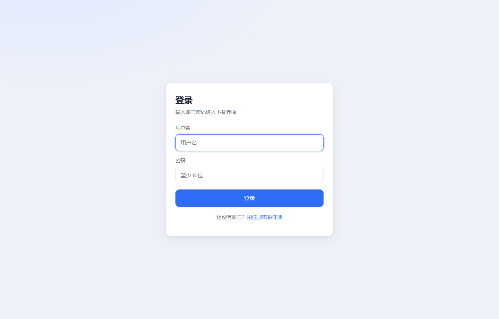
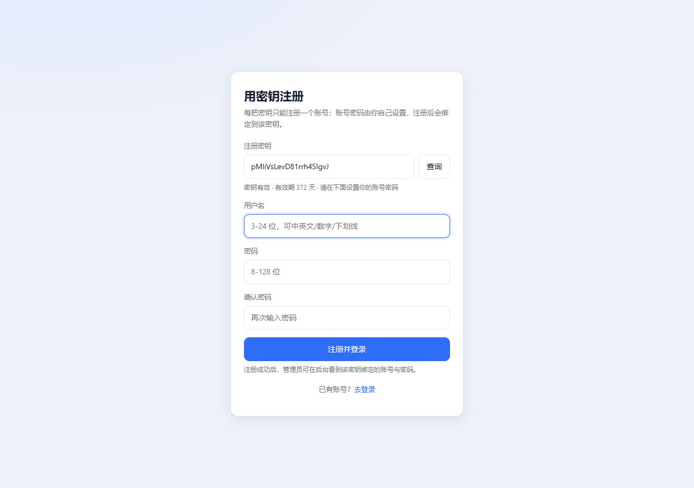
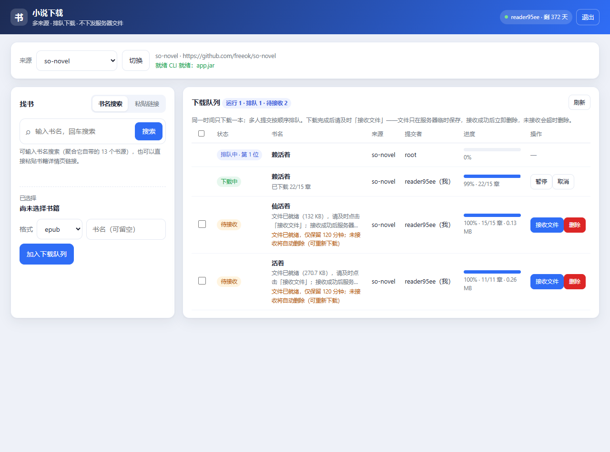
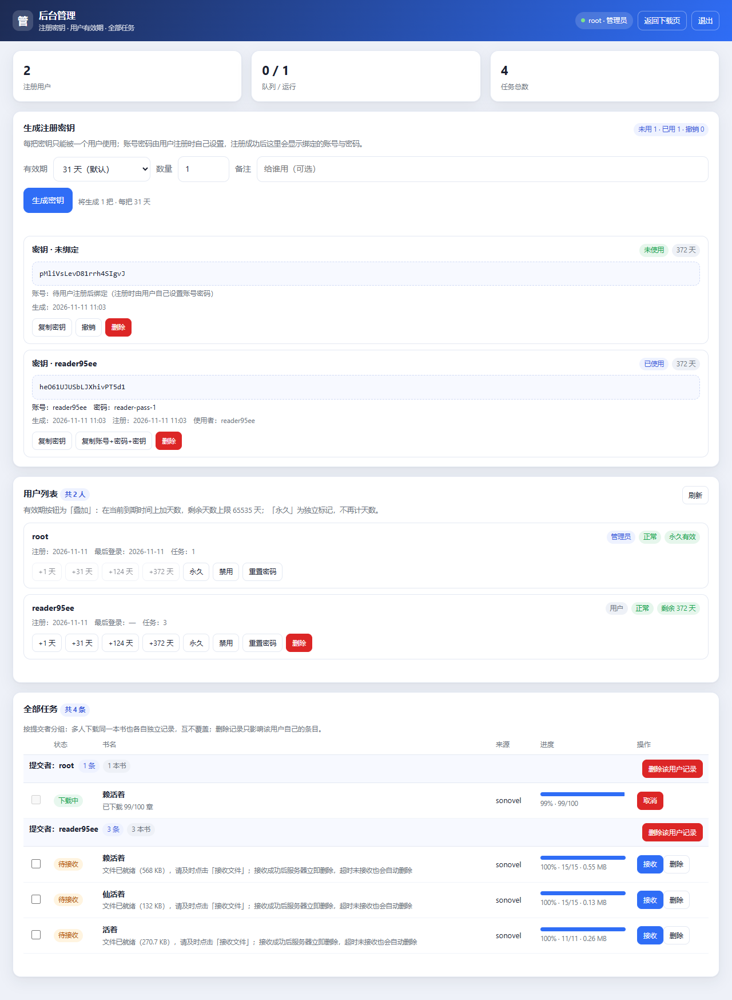
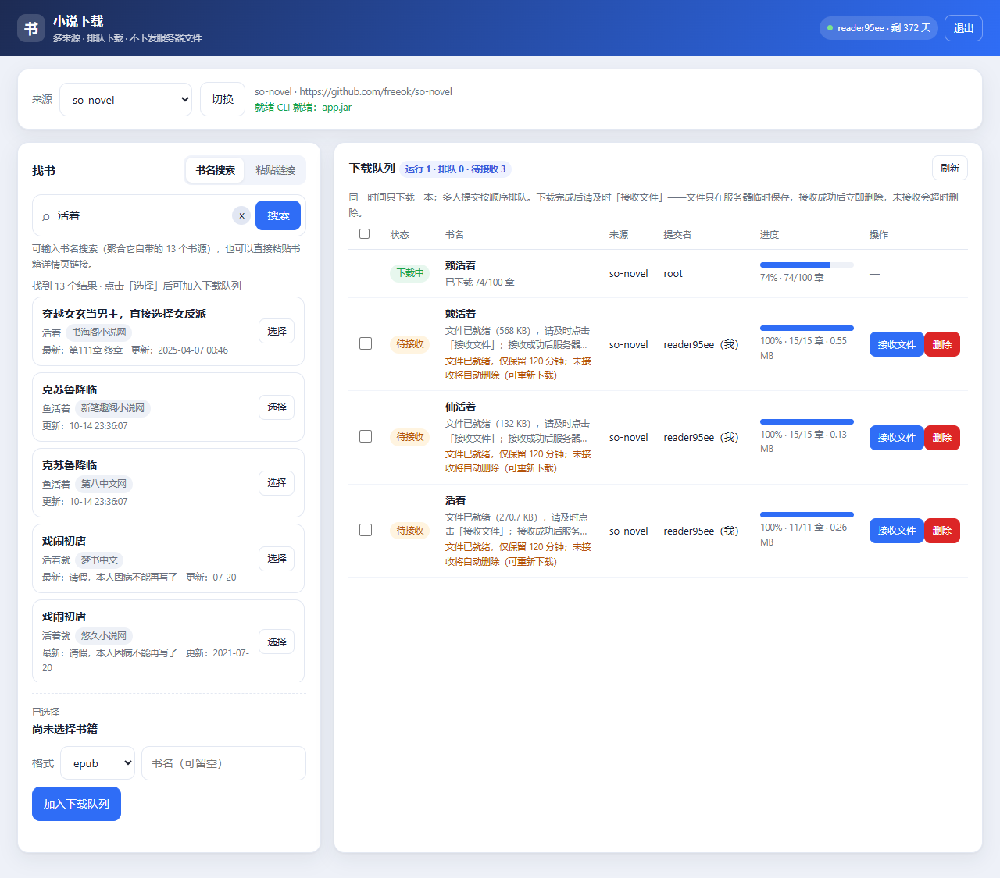
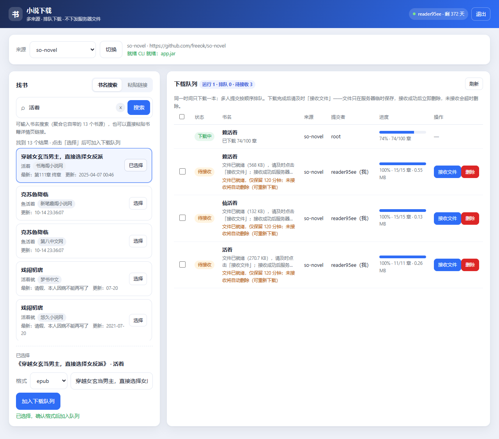
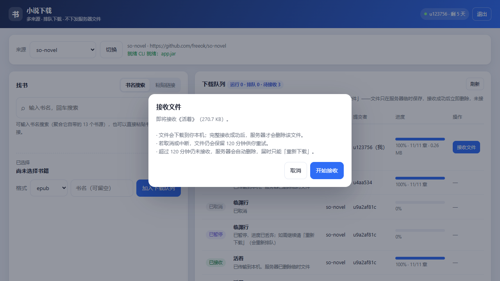
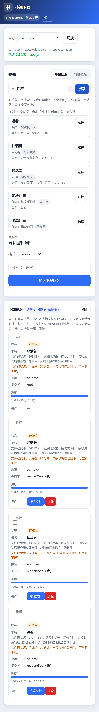

# 小说下载 WebUI（多来源插件 + 一钥一用户 + 不留存文件）

可部署在自己服务器上的网页端小说下载器。它本身**不实现站点解析或下载逻辑**，而是把两个成熟开源项目当作「来源插件」引用：

| 来源 ID | 上游项目 | 接入方式 | 能力 |
| --- | --- | --- | --- |
| `sonovel` | [freeok/so-novel](https://github.com/freeok/so-novel)（Java） | 直接调它自带的 **CLI**：`java -Dmode=cli -jar app.jar --url <详情页> --ext <格式>` | 按详情页链接下载；txt / epub / html / pdf |
| `tomato` | [zhongbai2333/Tomato-Novel-Downloader](https://github.com/zhongbai2333/Tomato-Novel-Downloader)（Rust） | 启动它自带的 **`--server`**，通过其 HTTP API 建任务/查进度/取文件 | 按书名搜索；txt / epub |

> 番茄上游禁用了 CLI 新建下载（`--download` 只保留报错，`--update` 只能更新已有书），所以引用它自带的 Web API。

## 核心机制

### 1) 密钥 = 一张「注册通行证」，一个用户一张

管理员只生成**密钥 + 有效期**，不生成账号密码：

- 用户打开 `/register`，先填密钥查询有效期，然后**自己设置用户名与密码**，注册成功；
- 注册成功后该密钥与这个账号**绑定**，后台密钥列表会显示：
  - 未绑定时：`账号：待用户注册后绑定`
  - 已绑定时：**账号 / 密码 / 使用者 / 注册时间**（可一键复制「账号+密码+密钥」）
- 每把密钥**只能注册一次**，注册后立即标记 `已使用`；未使用的可撤销、记录可删除；
- 有效期随密钥：生成时可选 `1 / 7 / 31 / 124 / 372` 天、**自定义天数（1-65535）**或 `999999`（永久），
  注册出的账号直接获得该时长；后台生成表单会实时显示「将生成 N 把 · 每把 X 天」。

> 说明：为了满足「后台显示账号密码」的需求，注册时设置的口令会以明文保存在密钥记录里。
> 请确保服务器与数据库文件权限安全；口令本身另以 scrypt 哈希保存用于登录校验。
> 管理员可随时用「重置密码」生成新口令（旧会话立即失效）。

### 1b) 抗暴力破解

登录、注册/激活、密钥查询都做了**持久化**的频率限制（存 SQLite，重启不可绕过）：

| 动作 | 维度 | 阈值 | 锁定 |
| --- | --- | --- | --- |
| 登录 | 账号 | 5 次失败 / 15 分钟 | 15 分钟 |
| 登录 | IP | 20 次失败 / 15 分钟 | 15 分钟 |
| 激活/注册 | IP | 10 次 / 60 分钟 | 60 分钟 |
| 密钥查询 | IP | 30 次 / 60 分钟 | 60 分钟 |

锁定期内即使密码正确也会被 429 拒绝；每次失败还会按次数线性增加响应延迟（最多 2 秒），让脚本撞库显著变慢；成功即清零。

### 2) 小说文件不在服务器留存

服务器只在**下载过程中**使用临时中转目录，交付方式如下：

```
上游 CLI/服务写盘 → data/runtime/tmp/<任务ID>/…（临时）
        ↓ 下载完成
任务状态 = 待接收（记录文件名/大小，DB 不存文件内容）
        ↓ 用户点「接收文件」（弹确认框说明：未接收会被删除）
GET /api/tasks/{id}/download → 流式传输到浏览器并保存
        ↓ 前端确认「已完整拿到」
POST /api/tasks/{id}/ack → 才删除临时目录，状态 = 已接收
        ↓ 若中断/未确认
文件继续保留，可重试；超过 TTL（默认 120 分钟）自动删除并标记「已过期」
```

**关键点：没有客户端确认就不会删文件。** 浏览器无法告诉服务端「用户是否真的保存成功」，
服务端也分不清「客户端收完」和「客户端断开但数据已进内核缓冲」，因此删除动作由前端在
完整取回文件后显式 ack 触发；最坏情况只是文件多留到 TTL 到期。

数据库只保存：**用户名、书名、来源、格式、章节数、文件大小、时间、状态** —— 没有文件内容，也没有长期的服务器副本。
页面上的「重新下载」会按原参数重新排队。

### 3) 全局单线程 + 多人排队 + 暂停不可续传
同一时刻只下载一本，其余任务排队并显示 `排队中 · 第 N 位`；所有人能看到共享队列，但只有本人（或管理员）能暂停/取消/接收自己的任务。

**暂停**：两个上游都没有可靠的「续传」能力（so-novel 明确无断点续传），所以暂停 = 终止并丢弃进度，临时文件一并删除；暂停后的任务**只能「重新下载」**，而重新下载会按原参数**重新加入队列**（生成新任务、重新排队，不会偷偷续传）。

### 3b) 搜索

- 番茄：走它自带的 `/api/search`；
- so-novel：临时拉起它的 `-Dmode=web` 实例调用 `/search/aggregated`（聚合 13 个书源），
  把结果里的**详情页链接**直接喂给它自己的 CLI 去下载 —— 搜索和下载都是上游原生能力。

搜索框也接受直接粘贴详情页链接（跳过搜索）。

### 3c) 多人同书互不覆盖 + 删除

- 每个任务有**独立的临时目录** `runtime/tmp/<task_id>/`，即使两个人同时下同一本书，
  产物、记录、进度也完全独立，不会互相覆盖；
- 后台任务列表**按提交者分组**（显示该用户几条记录、几本书），组内可一键删除该用户的记录，
  也可勾选任意条目批量删除（「删除选中」），或删单条；
- 删除语义：排队中/已结束 → 直接删记录（待接收的连同临时文件一起丢弃）；
  运行中 → 先取消，稍后再删一次；普通用户只能删自己的记录，管理员可删任意记录；
- **书名只认用户填写的内容**：上游日志/产物里识别出的书名只在用户没填书名时采用，
  so-novel 的日志按「本任务开始时间」过滤，避免读到上一个任务的日志导致书名/章数串台。

### 4) 来源切换

下拉框切换插件；切换时可选「等当前任务结束后切换」或「立即取消并切换」。

### 5) 响应式界面

桌面双栏；≤900px 单栏；≤760px 队列表格折叠为带字段标签的卡片；≤560px 顶栏上下两行。

## 界面

| 登录 | 用密钥注册 |
| --- | --- |
|  |  |

| 下载主界面 | 后台管理 |
| --- | --- |
|  |  |

| 书名搜索（结果卡片） | 选中后加入队列 |
| --- | --- |
|  |  |

| 接收确认（提示未接收会被删除） | 移动端（390×844） |
| --- | --- |
|  |  |

## 快速开始

### Docker

```bash
cd webapp
cp .env.example .env
# 必改：ADMIN_USERNAME / ADMIN_PASSWORD
docker compose up -d --build
# 打开 http://<服务器IP>:8080/
```

### 本机运行

```bash
cd webapp
pip install -r requirements.txt
export WEBAPP_DATA_DIR="$(pwd)/data"
export ADMIN_USERNAME=admin ADMIN_PASSWORD='至少8位的口令'
python scripts/fetch_plugins.py --with-java
python serve.py
```

## 使用流程

1. 管理员登录 `/login` → 进入 `/admin`。
2. 在「生成注册密钥」里选有效期与数量 → 生成密钥（不生成账号）。
3. 把密钥发给用户；用户在 `/register` 查询密钥 → **自己设置用户名与密码** → 注册并登录。
4. 后台密钥列表会显示该密钥绑定的账号与密码、使用者与注册时间。
5. 用户在首页**搜索书名或粘贴详情页链接** → 选中结果 → 选格式 → 加入队列。
6. 下载完成点「接收文件」→ 文件流式落到本机，服务器随即删除。
7. 中途可「暂停」，但暂停不保留进度；继续只能「重新下载」，会重新排队。
8. 到期/过期用户无法提交下载，管理员可在后台叠加 `+1/+31/+124/+372 天` 或设为永久。

## 权限模型

| 能力 | 未登录 | 未开通/过期 | 已登录且有效 | 管理员 |
| --- | --- | --- | --- | --- |
| 访问页面 | 跳 `/login` | ✅ | ✅ | ✅ |
| 查看队列 | ❌ 401 | ✅ | ✅ | ✅ |
| 提交下载 / 搜索 / 切换来源 | ❌ | ❌ 403 | ✅ | ✅ |
| 取消 / 接收别人的任务 | ❌ | ❌ | ❌ 403 | ✅ |
| 后台管理 | ❌ | ❌ | ❌ 403 | ✅ |

## 有效期与安全实现

- 密钥算法移植自 GitHub 开源项目 **[ai/nanoid](https://github.com/ai/nanoid)**（MIT）：密码学安全随机字节 + 掩码取模（越界字节按上游语义跳过），21 字符约 **126 bit 熵**；数据库对密钥/用户名/会话令牌加唯一约束并碰撞重试。
- 口令 `hashlib.scrypt`（n=16384, r=8, p=1，随机盐）；会话令牌只存 sha256，Cookie HttpOnly + SameSite=Lax，默认 30 天。
- 登录/注册按 IP 限流（每分钟 8 次）。
- 有效期：兑换密钥时按密钥天数确定；后台「叠加」按 `max(now, 到期时间) + days`，剩余天数封顶 **65535（uint16）**；`999999` 写永久标记。

## 环境变量

| 变量 | 默认 | 说明 |
| --- | --- | --- |
| `ADMIN_USERNAME` / `ADMIN_PASSWORD` | 空 | 管理员账号；不设置则后台不可用 |
| `WEBAPP_FILE_TTL_MIN` | `120` | 待接收临时文件的保留分钟数，超时自动删除 |
| `WEBAPP_COOKIE_SECURE` | `0` | HTTPS 部署设为 1 |
| `WEBAPP_HOST` / `WEBAPP_PORT` | `0.0.0.0` / `8080` | 监听地址 |
| `WEBAPP_DATA_DIR` | `webapp/data` | 数据目录（SQLite、临时中转目录、上游运行目录） |
| `WEBAPP_DEFAULT_SOURCE` | `sonovel` | 首次启动的默认来源 |
| `WEBAPP_TASK_TIMEOUT` | `0` | 单任务超时秒数，0 = 不限 |
| `WEBAPP_POLL_MS` | `1500` | 前端轮询间隔 |
| `SONOVEL_*` | 自动探测 | so-novel CLI 路径、工作目录（需含 `rules/`）、单本并发 |
| `TOMATO_*` | `18423` / `webapp-internal` | 番茄服务端口、内部口令、数据目录 |

## HTTP 接口

| 方法 | 路径 | 说明 |
| --- | --- | --- |
| GET | `/api/auth/key-info?key=` | 查询密钥类型/天数/预置账号（公开） |
| POST | `/api/auth/register` | `{key, username, password}`：用户自设账密并绑定密钥 |
| POST | `/api/auth/login` · `/logout` · GET `/api/auth/me` | 会话 |
| GET | `/api/meta` | 来源、注册是否开放、未用密钥数（公开） |
| GET | `/api/state` | 队列快照（`mine` / `can_cancel` / `can_receive` / `can_retry`） |
| POST | `/api/source` | 切换来源 |
| GET | `/api/search?q=` | 番茄搜索 |
| POST | `/api/tasks` | 入队 |
| DELETE | `/api/tasks/{id}` | 删除任务（排队/已结束直接删，运行中先取消） |
| POST | `/api/tasks/bulk-delete` | `{ids:[...]}` 批量删除自己的记录 |
| POST | `/api/tasks/{id}/pause` | 暂停：丢弃进度，只能重新下载 |
| GET | `/api/tasks/{id}/download` | **流式接收**（不会自动删除，等待客户端确认） |
| POST | `/api/tasks/{id}/ack` | 客户端确认已保存 → 删除服务器临时文件 |
| POST | `/api/tasks/{id}/retry` | 按原参数**重新排队** |
| GET/POST/DELETE | `/api/admin/keys` | 密钥列表 / 生成 / 撤销或删除 |
| GET | `/api/admin/overview` | 用户、密钥、任务、统计 |
| POST | `/api/admin/users/{id}/grant` | `{days}` ∈ 1/31/124/372/999999 |
| POST | `/api/admin/users/{id}/status` | active / banned |
| POST | `/api/admin/users/{id}/password` | 重置密码并返回新密码 |
| POST | `/api/admin/tasks/{id}/cancel` | 取消任意任务 |
| DELETE | `/api/admin/tasks/{id}` | 管理员删除任意任务记录 |
| POST | `/api/admin/tasks/bulk-delete` | 管理员批量删除记录 |
| GET | `/healthz` | 健康检查 |

## 测试

```bash
cd webapp

# 一条命令跑完所有模块（单元 + 黑盒 + 接口探针）
python tests/selftest_all.py

# 再加真实环境（需服务已启动）：真实搜索/下载/浏览器接收
python tests/selftest_all.py --live --url http://127.0.0.1:8099
```

也可以单独跑某个模块：

```bash
python tests/test_security.py        # 单元：nanoid（含小字母表越界）、口令、令牌
python tests/test_validity.py        # 单元：叠加、65535 封顶、永久
python tests/test_throttle.py        # 单元：撞库计数、锁定、持久化、作用域隔离
python tests/test_keys.py            # 单元：密钥只带时效、注册绑定、自定义天数
python tests/test_scheduler.py       # 单元：单线程、切换、归属、交付、暂停、TTL 过期
python tests/test_auth_blackbox.py   # 黑盒：真实 HTTP 的密钥/登录/权限/后台/锁定（18 组）
python tests/e2e_live.py             # 真实环境：密钥注册 + 聚合搜索 + 真实下载 + 接收 + 暂停
python tests/test_receive_browser.py # 浏览器：点「接收文件」真正落盘 + ack 后删除（Playwright）
CHROME_PATH=<chrome> python tests/shot_ui.py <目录>   # 可选：界面截图
```

维护：清空演示数据（保留管理员与上游二进制，先停服务）：

```bash
WEBAPP_DATA_DIR=/data python scripts/reset_demo.py
WEBAPP_DATA_DIR=/data python scripts/reset_demo.py --keep-users   # 只清任务与密钥
```

本机真实跑通：番茄 69 章 494 KB / 199 章 / 1184 章 / 2728 章进度；so-novel《活着》11/11 章 277 KB；
接收后服务器临时目录消失、数据库 `file_path` 为空。

**未在本机验证**：Docker 镜像构建（本机没有 Docker）。

## 与上游的关系

- 代码零侵入：不 fork、不打补丁、不复制解析/下载实现，只调用官方 Release 的 CLI / Web API。
- 升级上游：改 `Dockerfile` 里的 `SONOVEL_VERSION`/`TOMATO_VERSION`，或重跑 `scripts/fetch_plugins.py`。
- 上游行为提醒：so-novel 每次启动会上报一次主机信息（无开关）；番茄启动会做 GitHub 更新检查与 IID 预热。

## 免责声明

本项目只做「调用上游工具」的外壳与账号管理。下载内容的使用需遵守当地法律法规与目标站点条款，仅供个人阅读备份；上游项目各自的免责声明同样适用于其下载行为。
